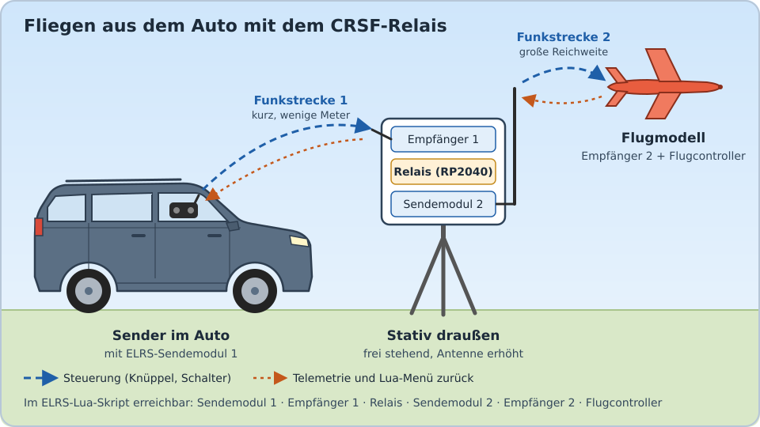

[English](README.md) | **Deutsch**

# CRSF-Relay für RP2040

Portierung des **RC-Relay32** von Wilhelm Meier
([wmucpp: `boards/rcRelay32`](https://github.com/wimalopaan/wmucpp/tree/master/boards/rcRelay32))
vom WeAct STM32G031 auf den RP2040, Zielboard **Waveshare RP2040-Zero**.

Das Relais verbindet zwei CRSF-Funkstrecken: Der Empfänger der ersten Strecke speist das Relais,
das Relais steuert das Sendemodul der zweiten Strecke. Alle Geräte bleiben über `elrsV3.lua`
(bzw. TBS Agent) erreichbar, die Telemetrie läuft kollisionsfrei zurück.



Ein typischer Einsatz: Der Sender bleibt im Auto, die Karosserie schirmt das Funksignal aber ab.
Ein Empfänger mit dem Relais und einem zweiten Sendemodul steht deshalb draußen auf einem Stativ.
Die kurze erste Funkstrecke reicht vom Auto bis zum Stativ, die zweite Strecke vom Stativ zum
Flugmodell hat freie Sicht und volle Reichweite.

## Flashen

1. Die aktuelle UF2-Datei unter **Releases** herunterladen (`crsf-relay-<version>-rp2040-zero.uf2`).
2. RP2040-Zero mit gedrückter **BOOT**-Taste an USB anstecken. Es erscheint das Laufwerk `RPI-RP2`.
3. Die UF2-Datei auf das Laufwerk kopieren. Fertig.

Ist die Firmware bereits drauf, geht es auch ohne Taste: Im USB-Terminal `b` senden,
oder `picotool load -f -x crsf-relay-…uf2` verwenden.

## Anschluss (RP2040-Zero)

| RP2040-Zero | Signal                                   | Original (WeAct) |
|-------------|------------------------------------------|------------------|
| GP0         | → RX des Empfängers 1 (CRSF-Eingang)     | PA2              |
| GP1         | ← TX des Empfängers 1                    | PA3              |
| GP4         | → RX des Sendemoduls 2 (Vollduplex) **bzw. die Signalleitung im Halbduplex** | PA9 |
| GP5         | ← TX des Sendemoduls 2 (nur Vollduplex)  | PA10             |
| GP29        | Versorgungsspannung über Teiler (optional) | –              |
| GP16        | RGB-LED auf der Platine                   | PA4 (LED)        |
| GND, 5V     | gemeinsame Masse, Versorgung              |                  |

* Alle Signale sind 3,3-V-Pegel, nicht invertiert (CRSF-Standard). Interne Pull-ups sind aktiv.
* **Vollduplex** (ELRS-Empfänger als Sender, „RX-as-TX“): GP4/GP5 kreuzen wie gewohnt.
* **Halbduplex** (JR-Bay- bzw. externes ELRS-Modul): nur **GP4** an den CRSF-/S.Port-Pin des Moduls.
  Im Menü „Half-Duplex“ auf „On“ stellen. Externe Module brauchen ihre eigene Versorgung
  (meist 5–8,4 V und je nach Sendeleistung mehr als 1 A), nicht aus dem 3,3-V-Pin des RP2040-Zero.
* Spannungsmessung: Vin – 33 kΩ – GP29 – 10 kΩ – GND (bis ca. 14 V). Andere Werte über
  `VSENSE_R1`/`VSENSE_R2` beim Bauen. Ohne Teiler zeigt der Menüpunkt Unsinn, sonst stört es nicht.

## LED

| Farbe / Muster                    | Zustand                                       |
|-----------------------------------|-----------------------------------------------|
| blau, dauerhaft                   | Init: wartet auf Empfänger 1                  |
| grün, 2× langsam                  | Run: Kanaldaten von Empfänger 1 (Halbduplex: cyan) |
| rot, 1× schnell                   | keine Kanaldaten von Empfänger 1              |

## Menü (elrsV3.lua)

Das Relais meldet sich als `RC-Relay32@205` (205 = 0xCD, die eigene CRSF-Adresse).
Das Sendemodul 2 erscheint unter Adresse 206 (0xCE), dessen Empfänger unter 207 (0xCF).

Ganz oben zeigt der Eintrag **RP2040 Firmware** die Firmware-Version dieses Ports
(z. B. `1.0.6`). So ist im Lua-Skript sofort zu sehen, dass der RP2040-Port läuft und in
welcher Version. **Total Retries** zählt die Parameteranfragen, die das Relais seit dem
Einschalten wiederholt hat (Punkt 7 unter „Unterschiede zum Original“); steigt der Wert, ist die Verbindung hinter dem Relais schwach.

Alle Menüpunkte und Standardwerte des Originals sind vorhanden:
CRSF Address, TX/RX Rewrite Address, TX Rewrite Name, Rewrite Name, LinkStat
(Off/Forward/Transform/Tunnel), Failsafe (Forward/Hold), Telem. Off Dur.,
Ordner „Telemetry forwarding“ (Forward Rate + Off/Forward/Tunnel je Sensortyp),
Half-Duplex, Baudrate (400k/420k/460k/921k/1,87M).

Neu im Ordner „Telemetry forwarding“:

* **ArduPilot** (Off/Forward/Tunnel, Standard Forward): ArduPilot-Passthrough-Telemetrie
  (CRSF-Typ 0x80, z. B. für Yaapu). Sie wird während eines Lua-Zugriffs wie alle Telemetrie
  pausiert, und die Forward Rate gilt getrennt je Telemetriewert (AppId), damit kein Wert
  ausgedünnt wird. Statustexte werden nie ausgedünnt. INAV sendet keinen Typ 0x80, dort hat
  der Menüpunkt keine Wirkung. Im Tunnel-Modus werden Sammelpakete, die zusammen mit dem
  Tunnel-Kopf über 64 Byte kämen, verworfen.

Neu (aus der ToDo-Liste des Originals):

* **Watchdog**: Anzahl der Watchdog-Resets seit dem Einschalten (Watchdog 500 ms)
* **Supply Volt.** und **Chip Temp.**: Anzeige im Menü
* **Own Telemetry**: sendet Spannung (CRSF 0x0E) und Chiptemperatur (0x0D) einmal pro Sekunde
  mit der Relais-Adresse als Sensor-ID. In EdgeTX erscheinen sie als eigene Sensoren und kollidieren
  nicht mit den Sensoren des Modells. Standard: aus.

## USB-Konsole

> **Achtung:** Beim RP2040-Zero ist der 5V-Pin direkt mit der USB-Buchse verbunden (keine Diode).
> Vor dem Anstecken von USB die externe 5-V-Leitung zum RP2040-Zero abklemmen, **GND verbunden
> lassen**. Sonst speist die externe Versorgung in den USB-Port des Rechners zurück (Neustart oder
> Schaden am Port möglich). Alternativ ein USB-Kabel ohne 5-V-Ader („USB Power Blocker“) verwenden.

Das Relais meldet sich als serielles USB-Gerät (beliebiges Terminal, Baudrate egal).
Es gibt Debug-Meldungen wie im Original (`# Run`, `# UnCon`, …) und diese Befehle:

| Taste | Funktion |
|-------|----------|
| `s`   | Status: Zustand, Paketzähler, CRC-/Rahmenfehler, Spannung, Temperatur |
| `p`   | Parameter-Protokoll an/aus: Zeitstempel jeder Anfrage an Modul 2 / Empfänger 2 und jeder Antwort |
| `b`   | Neustart in den UF2-Bootloader |
| `r`   | Neustart |
| `d`   | Werkseinstellungen und Neustart |

## Unterschiede zum Original

Die Logik entspricht `package_relay_rewrite.h`, `crsf_2*.h`, `crsf_cb.h` und `gfsm.h`
im Stand vom 8.11.2026. Übernommen aus dieser Überarbeitung: Das Relais startet ausgeschaltet und
wird erst im Zustand „Run“ aktiv. „Run“ wird auch ohne Linkstatistik erreicht, wenn nur Kanalpakete
ankommen (direkte Verbindung). Ungültige Parameterwerte werden abgelehnt und nicht gespeichert.

Bewusste Abweichungen:

1. **Halbduplex-Zeitverhalten**: Nachrichten an das Modul (Ping, Parameter, Kommandos) werden
   direkt hinter einem Kanalpaket im selben Burst gesendet, eine pro 10-ms-Periode, so wie
   EdgeTX es macht. Dadurch können sie nicht mit der Antwort des Moduls kollidieren.
   Vollduplex läuft wie im Original.
2. **Keine Mittelwerte vor dem ersten Kanalpaket**: Kanäle werden erst nach dem ersten echten
   Kanalpaket weitergegeben. Seit dem 8.11.2026 verhindert das Original dies ebenfalls, über den
   ausgeschalteten Start. Hier gilt zusätzlich die Prüfung auf echte Kanaldaten.
3. **„Telem. Off Dur.“ in echten Sekunden**: Im Original läuft der Zähler mit halber Dauer
   (dort inzwischen in der README dokumentiert).
4. **Speed-Kommando** bei Rahmenfehlern schlägt die eingestellte Baudrate vor (Original: immer 400k)
   und enthält die vom CRSF-Standard verlangte Kommando-CRC. ELRS ignoriert dieses Kommando ohnehin.
   ELRS-Module erkennen Baudrate und Invertierung selbst.
5. **Parser**: Der Eingangsparser synchronisiert sich nach CRC-Fehlern Byte für Byte neu,
   statt den Rest des Bursts zu verwerfen. TX-Name und Tunnel-Pakete werden wie im aktuellen
   Original sicher begrenzt.
6. **Einstellungen** liegen im letzten Flash-Sektor (mit Prüfsumme). Sie werden 0,5 s nach der
   letzten Änderung gespeichert, damit mehrere Änderungen aus dem Lua-Skript nur einen
   Schreibvorgang auslösen. Einstellungen älterer Versionen werden beim Update übernommen,
   neue Menüpunkte bekommen ihren Standardwert.
7. **Wiederholung von Parameteranfragen**: Das ELRS-Lua-Skript wartet bei allen Geräten außer dem
   eigenen Sendemodul 5 s, bevor es eine unbeantwortete Anfrage wiederholt. Hinter dem Relais geht
   gelegentlich eine Antwort auf der Seite von Modul 2 verloren, das kostete jedes Mal 5 s.
   Das Relais wiederholt Leseanfragen an alle Geräte hinter sich (Modul 2, Empfänger 2 und z. B.
   den ArduPilot-Flugcontroller unter 0xC8) jetzt selbst, wenn die Antwort ausbleibt: nach dem
   Dreifachen der gemessenen Laufzeit, mindestens 0,1 s (Modul 2) bzw. 0,5 s (über Funk),
   höchstens 1,5 s, bis zu dreimal. Doppelte Antworten durch diese Wiederholungen werden verworfen.
   Schreibanfragen werden nie wiederholt. Zähler: `s` in der USB-Konsole.
8. **ArduPilot-Telemetrie (0x80)**: Das Original behandelt diesen Typ wie ein Paket mit
   Ziel-/Quelladresse. Es leitet ihn deshalb immer weiter, auch während die Telemetrie für den
   Lua-Zugriff pausiert, und schreibt die Bytes 3 und 4 um, falls sie wie Adressen aussehen.
   Hier ist 0x80 normale Telemetrie mit eigenem Menüpunkt (siehe oben).
9. **IrDA** entfällt (beim WeAct-Build ohnehin nicht aktiv, der RP2040 hat kein IrDA).

Die Punkte 7 und 8 sind inzwischen auch ins Original übernommen (V17), Punkt 1 ist dort vorgeschlagen.

Die Protokolllogik ist mit Host-Tests geprüft (`test/test_core.cpp`), die Halbduplex-PIO-Programme
mit einem Zyklus-Simulator (`test/pio_sim.py`). Beides läuft bei jedem Push automatisch.

## Bauen

GitHub Actions baut die Firmware bei jedem Push automatisch und führt die Tests aus
(Download unter „Actions“ → Lauf → „Artifacts“). Bei einem Tag `v<version>` oder einem auf
GitHub veröffentlichten Release wird die UF2-Datei angehängt.

Lokal: Pico SDK 2.1.1, CMake, Ninja, arm-none-eabi-gcc:

```sh
export PICO_SDK_PATH=/pfad/zum/pico-sdk
./build_all.sh                      # -> dist/crsf-relay-<version>-rp2040-zero.uf2
```

Andere Pins: z. B. `cmake -B build -DPIN_RELAY_TX=8 -DPIN_RELAY_RX=9 .`
(GP8/9 sind ebenfalls UART1). Für einen Raspberry Pi Pico: `-DPICO_BOARD=pico`.
Die RGB-LED gibt es dort nicht, sonst ist alles gleich.

Tests:

```sh
cd test && g++ -std=c++17 -I../src test_core.cpp ../src/core.cpp -o test_core && ./test_core
python3 test/pio_sim.py build/rp2040-zero/hd_uart.pio.h
```

## Struktur

| Datei | Inhalt |
|-------|--------|
| `src/crsf.h`      | CRSF-Konstanten, CRC, Frame-Builder, Stream-Parser, Queue |
| `src/core.cpp`    | Relais-Logik, Menü, Geräteinfo, Zustandsmaschine (hardwareunabhängig) |
| `src/ports.cpp`   | UART0/UART1 mit IRQ-Empfang und DMA-Senden, PIO-Halbduplex |
| `src/hd_uart.pio` | Halbduplex-UART-Programme (Senden mit Leitungsfreigabe, Empfangen mit Rahmenprüfung) |
| `src/main.cpp`    | Hauptschleife, Flash-Speicher, LED, ADC, Watchdog, USB-Konsole |
| `src/config.h`    | Pins, Spannungsteiler, Versionsnummern |

## Haftungsausschluss

Die Benutzung erfolgt auf eigene Gefahr. Das Relais steht im Steuerweg zum Flugmodell: Prüfe vor
jedem Flug Reichweite, Failsafe-Verhalten und Telemetrie am Boden und beachte die für dich
geltenden Regeln für den Modellflug. Eine Gewähr für Funktion oder Eignung wird nicht übernommen
(siehe auch GPL-3.0, Abschnitte 15 und 16).

## Lizenz

GPL-3.0-or-later wie das Original. Original: Copyright (C) 2019–2026 Wilhelm Meier.
