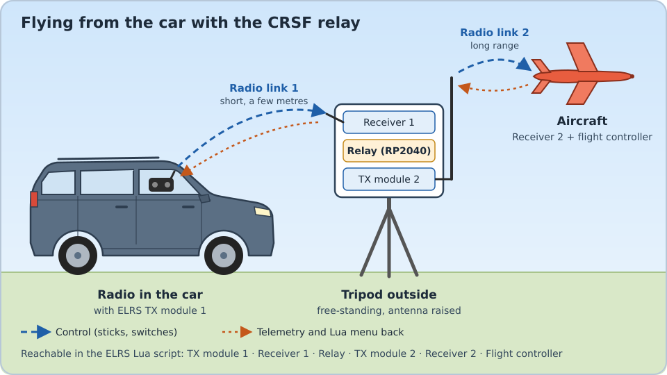

**English** | [Deutsch](README.de.md)

# CRSF relay for RP2040

Port of the **RC-Relay32** by Wilhelm Meier
([wmucpp: `boards/rcRelay32`](https://github.com/wimalopaan/wmucpp/tree/master/boards/rcRelay32))
from the WeAct STM32G031 to the RP2040, target board **Waveshare RP2040-Zero**.

The relay connects two CRSF radio links: the receiver of the first link feeds the relay, and the
relay drives the TX module of the second link. All devices remain reachable through `elrsV3.lua`
(or TBS Agent), and telemetry is passed back without collisions.



A typical use case: the radio stays in the car, but the car body shields the radio signal.
A receiver with the relay and a second TX module therefore stands outside on a tripod.
The short first link covers the distance from the car to the tripod, the second link from the
tripod to the aircraft has a clear line of sight and full range.

## Flashing

1. Download the current UF2 file from **Releases** (`crsf-relay-<version>-rp2040-zero.uf2`).
2. Plug the RP2040-Zero into USB while holding the **BOOT** button. A drive `RPI-RP2` appears.
3. Copy the UF2 file to that drive. Done.

If the firmware is already installed, no button is needed: send `b` in a USB terminal,
or use `picotool load -f -x crsf-relay-…uf2`.

## Wiring (RP2040-Zero)

| RP2040-Zero | Signal                                   | Original (WeAct) |
|-------------|------------------------------------------|------------------|
| GP0         | → RX of receiver 1 (CRSF input)          | PA2              |
| GP1         | ← TX of receiver 1                       | PA3              |
| GP4         | → RX of TX module 2 (full duplex) **or the signal line in half duplex** | PA9 |
| GP5         | ← TX of TX module 2 (full duplex only)   | PA10             |
| GP29        | Supply voltage via divider (optional)    | –                |
| GP16        | RGB LED on the board                     | PA4 (LED)        |
| GND, 5V     | Common ground, supply                    |                  |

* All signals are 3.3 V level, not inverted (CRSF standard). Internal pull-ups are enabled.
  The relay side can be inverted via the menu entry "Inverted" (e.g. for mLRS, see below).
* **Full duplex** (ELRS receiver used as transmitter, "RX-as-TX"): cross GP4/GP5 as usual.
* **Half duplex** (JR bay or external ELRS module): connect only **GP4** to the CRSF/S.Port pin of
  the module and set "Half-Duplex" to "On" in the menu. External modules need their own supply
  (usually 5–8.4 V and, depending on output power, more than 1 A), not the 3.3 V pin of the RP2040-Zero.
* Voltage measurement (optional, since 1.0.11 only with `HAS_VSENSE=1` at build time): Vin – 33 kΩ –
  GP29 – 10 kΩ – GND (up to approx. 14 V). Other values via
  `VSENSE_R1`/`VSENSE_R2` at build time. Without a divider leave `HAS_VSENSE` at 0 (the open pin gives random values);
  with a divider the voltage is shown in the menu and sent with "Own Telemetry".

## LED

| Colour / pattern                  | State                                          |
|-----------------------------------|------------------------------------------------|
| blue, steady                      | Init: waiting for receiver 1                   |
| green, 2× slow                    | Run: channel data from receiver 1 (half duplex: cyan) |
| red, 1× fast                      | no channel data from receiver 1                |

## Menu (elrsV3.lua)

The relay reports itself as `RC-Relay RP2040` (CRSF address 205 = 0xCD; up to 1.0.12 the name was
`RC-Relay32@205` like the original).
TX module 2 appears at address 206 (0xCE), its receiver at 207 (0xCF).

The first entry, **Firmware**, shows the firmware version of this port (e.g. `1.1.2`),
so the Lua script immediately shows that the RP2040 port is running and which version.
**Total Retries** counts the parameter requests the relay has repeated since power-up
(see item 7 under "Differences from the original"); a rising value indicates a weak link behind the relay.

Menu (since 1.0.11): info block (Firmware, Watchdog, Total Retries, [Supply Volt.],
Chip Temp.), LinkStat (Off/Forward/Transform/Tunnel), **Telemetry** (Off/Forward), Forward Rate,
ArduPilot (Off/Forward/Tunnel), Half-Duplex, Baudrate (400k/420k/460k/921k/1.87M),
**Inverted** (Off/On), Own Telemetry.

* **LinkStat** handles all link statistics of module 2: 0x14 as selected, and the frames 0x1C/0x1D
  (e.g. sent by mLRS) are passed on only with "Forward", otherwise they would duplicate the
  transformed values.
* **Telemetry** replaces the folder "Telemetry forwarding" of the original (one entry per sensor
  type, 1.0.8 and older): all telemetry types of that list are passed on or not. Tunnelling single
  sensor types is no longer possible.

Since 1.0.8 the following entries of the original are no longer in the menu; their values are fixed
to the defaults (stored values from older versions are ignored): Version(HW/SW), CRSF Address (205),
TX/RX Rewrite Address (206/207), TX Rewrite Name, Rewrite Name (off), **Failsafe (fixed to Forward:
the relay stops when receiver 1 is lost, so the model goes into its own failsafe)**,
Telem. Off Dur. (30 s). The setting "Hold" of the original kept sending the last channel values
and prevented the model's failsafe.

New:

* **ArduPilot** (Off/Forward/Tunnel, default Forward): ArduPilot passthrough telemetry
  (CRSF type 0x80, e.g. for Yaapu). Like all telemetry it is paused while the Lua script accesses
  parameters, and the Forward Rate applies per telemetry value (AppId) so that no value is thinned
  out completely. Status texts are never thinned out. INAV does not send type 0x80, so the entry
  has no effect there. In Tunnel mode, multi packets that would exceed 64 bytes together with the
  tunnel header are dropped.

New (from the ToDo list of the original):

* **Watchdog**: number of watchdog resets since power-up (watchdog 500 ms)
* **Supply Volt.** (only with `HAS_VSENSE=1`) and **Chip Temp.**: shown in the menu
* **Own Telemetry**: sends the chip temperature (0x0D) and, with `HAS_VSENSE=1`, the voltage (CRSF 0x0E) once per second,
  with the relay address as sensor ID. In EdgeTX they appear as separate sensors and do not
  collide with the aircraft's sensors. Default: off.

## mLRS as link 2 (experimental)

The relay can feed an mLRS TX module (tested: MatekSys mR900-30 as TX) instead of an ELRS module,
e.g. internal ELRS module of the radio → ELRS receiver → relay → mLRS TX → mLRS receiver in the model.

* Half duplex: GP4 to the JR pin 5 / "In" pin of the mLRS TX, "Half-Duplex" = On.
* mLRS expects CRSF **inverted** at 400k/921k/1.87M and non-inverted only at 416,666 baud.
  So either "Baudrate" = 420k with "Inverted" = Off, or 400k/921k with "Inverted" = On.
* The mLRS TX detects baud rate and polarity only during about 6 s after power-up. It must
  therefore receive channels from the relay in this time: switch on the radio first, then the relay
  box (relay and mLRS TX together).
* In half duplex the relay sends to an mLRS TX one frame per period (like EdgeTX): a queued frame
  replaces the channels of that period instead of being appended, because mLRS answers right after
  the first frame (1.0.12).
* **Failsafe** (1.1.1): an mLRS TX keeps sending the last channel values when its input stops, so
  the relay cannot simply stop sending. When receiver 1 is lost, the relay therefore selects another
  mLRS config (like changing the "Receiver ID" in EdgeTX): config id + 1 (e.g. 0 → 1). Its bind
  phrase differs (default "mlrs.N"), so the link to the model breaks and the mLRS receiver goes into
  its failsafe. When receiver 1 is back, the relay selects the original config again and the link
  is re-established after a few seconds. Dropouts shorter than 0.75 s cause nothing (mLRS applies a
  change only after that time). **Do not bind the model to the config id + 1 with the same bind
  phrase**, and test the failsafe before flying.
* Recommended: LinkStat = Transform. The flight controller's data (GPS, battery, attitude,
  flight mode …) are generated by the mLRS TX from MAVLink and arrive as normal sensors.
* **mLRS parameters in the ELRS Lua script** (1.0.9, requires mLRS v1.4.04 or newer): the mLRS
  TX appears in the device list of the ELRS Lua script (e.g. "Matek mR900-30"). The relay loads
  its parameters in the background via mBridge (the protocol of the mLRS Lua script) and shows
  them there: TX and RX name/version, the command **Save**, and the folders "General", "Tx", "Rx"
  and "Rx Failsafe". Changes take effect only after "Save", like in the mLRS Lua script;
  afterwards the relay reloads the list. A folder with changes not saved yet shows
  "(n unsaved)" in its name (1.1.0); after "Save" the marks disappear when the Lua script is opened
  again (it caches names). Rx parameters are shown only while the mLRS receiver is
  connected. Read-only: Bind Phrase (the ELRS Lua script cannot edit text), parameters with a
  single possible value. If the device shows "loading", leave the Lua script and open it again.
  Status in the USB console (`s`).

## USB console

> **Caution:** On the RP2040-Zero the 5V pin is connected directly to the USB socket (no diode).
> Before plugging in USB, disconnect the external 5 V supply from the RP2040-Zero and **keep GND
> connected**. Otherwise the external supply feeds back into the computer's USB port (reboot or
> damage to the port possible). Alternatively use a USB cable without the 5 V wire ("USB power blocker").

The relay appears as a USB serial device (any terminal, baud rate does not matter).
It prints debug messages like the original (`# Run`, `# UnCon`, …) and accepts these commands:

| Key | Function |
|-----|----------|
| `s` | Status: state, packet counters, CRC/framing errors, voltage, temperature |
| `p` | Parameter trace on/off: timestamp of every request to module 2 / receiver 2 and every answer |
| `b` | Reboot into the UF2 bootloader |
| `r` | Reboot |
| `d` | Factory defaults and reboot |

## Differences from the original

The logic follows `package_relay_rewrite.h`, `crsf_2*.h`, `crsf_cb.h` and `gfsm.h`
as of 8 Nov 2026. Taken over from that revision: the relay starts disabled and becomes active only
in state "Run". "Run" is also reached without link statistics if only channel packets arrive
(direct connection). Invalid parameter values are rejected and not stored.

Intentional differences:

1. **Half duplex timing**: messages to the module (ping, parameters, commands) are sent directly
   behind a channels frame in the same burst, one per 10 ms period, the way EdgeTX does it.
   This way they cannot collide with the module's answer. Full duplex works as in the original.
2. **No centre values before the first channels frame**: channels are passed on only after the
   first real channels frame. Since 8 Nov 2026 the original prevents this as well, by starting
   disabled. Here the check for real channel data applies in addition.
3. **"Telem. Off Dur." in real seconds**: in the original the timer runs at half the duration
   (documented in its README by now).
4. **Speed command** on framing errors proposes the configured baud rate (original: always 400k)
   and contains the command CRC required by the CRSF standard. ELRS ignores this command anyway;
   ELRS modules detect baud rate and inversion by themselves.
5. **Parser**: the input parser resynchronises byte by byte after CRC errors instead of
   discarding the rest of the burst. TX name and tunnel packets are limited safely, as in the
   current original.
6. **Settings** are stored in the last flash sector (with checksum). They are written 0.5 s after
   the last change, so several changes from the Lua script cause only one write. Settings of older
   versions are kept on update, new menu entries get their default value.
7. **Retry of parameter requests**: the ELRS Lua script waits 5 s before repeating an unanswered
   request to any device except its own TX module. Behind the relay an answer occasionally gets
   lost on the side of module 2, which cost 5 s each time. The relay now repeats read requests to
   all devices behind it (module 2, receiver 2 and e.g. the ArduPilot flight controller at 0xC8)
   by itself if the answer does not arrive: after three times the measured round trip time, at
   least 0.1 s (module 2) or 0.5 s (over the radio link), at most 1.5 s, up to three times.
   Duplicate answers caused by these retries are dropped. Write requests are never repeated.
   Counters: `s` in the USB console.
8. **ArduPilot telemetry (0x80)**: the original treated this type like a packet with destination
   and source address. It therefore always forwarded it, even while telemetry was paused for Lua
   access, and rewrote bytes 3 and 4 if they looked like addresses. Here 0x80 is regular telemetry
   with its own menu entry (see above).
9. **IrDA** is omitted (not active in the WeAct build anyway; the RP2040 has no IrDA).
10. **Reduced menu and fixed failsafe** (1.0.8), see "Menu".
11. **TFPS with LinkStat = Transform** (1.0.8): up to 1.0.7 the RF mode of the link
    statistics was copied into the packet rate field, so EdgeTX showed e.g. 310 Hz for the mLRS 31 Hz mode.
    Known modes are now converted (CRSF 4/50/150/250 Hz, mLRS 19/31/111 Hz), unknown ones give 0.
12. **One telemetry switch instead of a folder** (1.0.9), see "Menu".
13. **mLRS parameter proxy** (1.0.9), see "mLRS as link 2".

Items 7 and 8 have since been taken over into the original (V17); item 1 has been proposed there.

The protocol logic is checked with host tests (`test/test_core.cpp`), the half-duplex PIO programs
with a cycle simulator (`test/pio_sim.py`). Both run automatically on every push.

## Building

GitHub Actions builds the firmware on every push and runs the tests
(download under "Actions" → run → "Artifacts"). A tag `v<version>` or a release published on
GitHub gets the UF2 file attached.

Locally: Pico SDK 2.1.1, CMake, Ninja, arm-none-eabi-gcc:

```sh
export PICO_SDK_PATH=/path/to/pico-sdk
./build_all.sh                      # -> dist/crsf-relay-<version>-rp2040-zero.uf2
```

Other pins: e.g. `cmake -B build -DPIN_RELAY_TX=8 -DPIN_RELAY_RX=9 .`
(GP8/9 are UART1 as well). For a Raspberry Pi Pico: `-DPICO_BOARD=pico`.
It has no RGB LED, otherwise everything is the same.

Tests:

```sh
cd test && g++ -std=c++17 -I../src test_core.cpp ../src/core.cpp -o test_core && ./test_core
python3 test/pio_sim.py build/rp2040-zero/hd_uart.pio.h
```

## Structure

| File | Content |
|------|---------|
| `src/crsf.h`      | CRSF constants, CRC, frame builder, stream parser, queue |
| `src/core.cpp`    | Relay logic, menu, device info, state machine (hardware independent) |
| `src/mlrs.cpp`    | mLRS parameter proxy (mBridge ↔ ELRS parameter protocol) |
| `src/ports.cpp`   | UART0/UART1 with IRQ receive and DMA transmit, PIO half duplex |
| `src/hd_uart.pio` | Half-duplex UART programs (transmit with line release, receive with framing check) |
| `src/main.cpp`    | Main loop, flash storage, LED, ADC, watchdog, USB console |
| `src/config.h`    | Pins, voltage divider, version numbers |

## Disclaimer

Use at your own risk. The relay is part of the control path to the aircraft: before every flight,
check range, failsafe behaviour and telemetry on the ground, and follow the model flying rules
that apply to you. No warranty is given for function or fitness for a particular purpose
(see also GPL-3.0, sections 15 and 16).

## License

GPL-3.0-or-later, like the original. Original: Copyright (C) 2019–2026 Wilhelm Meier.
